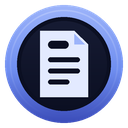
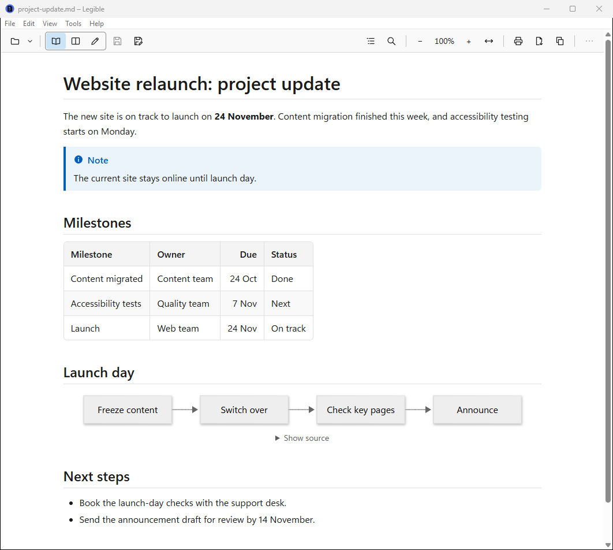
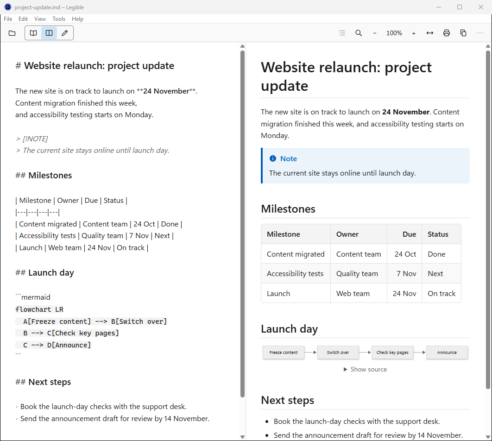

<p align="center"></p>

# Legible

[](https://github.com/Suremise/legible/actions/workflows/release.yml)
[](LICENSE)

**A reader that makes Markdown legible.**

<picture>
  <source media="(prefers-color-scheme: dark)" srcset="docs/screenshots/legible-dark.png">
  
</picture>

Notes, reports, meeting minutes and documentation are more and more often written in Markdown,
the plain-text format behind GitHub, Teams and many AI tools. Opened in Notepad, a Markdown file
is a wall of hashes and asterisks. Opened in Legible, it reads like a document: clear type,
proper headings, tables, lists, code and diagrams, in light or dark as Windows is.

Double-click a `.md` file and it opens in its own window, at once. Copy it into an email, print
it or save it as a PDF, and it still looks right. When it needs a change, edit it in the same
window.

Legible is free and open source (MIT), for Windows 10 and 11.

> **Status:** version 0.1.0, the first release, is being prepared. When it's out it will be on
> [Releases](https://github.com/Suremise/legible/releases) ([Installing](#installing), below);
> until then, [build it from source](#building-from-source).

**[The user guide](docs/user-guide.md)** covers every feature in plain language, and what to do
when something doesn't work as you expect.

## What it shows

- **Everything GitHub shows:** headings, lists, task lists, tables, links, footnotes,
  ~~strikethrough~~, quotes, and **alerts** (`> [!NOTE]`, `> [!WARNING]` and the rest) as
  coloured boxes.
- **Properties:** the block of details at the top of many notes (front matter, in YAML or TOML)
  shows as a neat table you can fold away.
- **Code** with its colours, and a Copy button on each block.
- **Diagrams:** [Mermaid](https://mermaid.js.org) flowcharts, sequence diagrams, Gantt charts, pie
  charts, mind maps and the rest are drawn, in light and dark.
- **Pictures** beside the document, and pictures from the internet once you allow them
  ([Privacy](#privacy), below).

And to find your way round it: an **outline** of the headings (shown by itself for long
documents), **find** (Ctrl+F), **zoom** (Ctrl+Plus and Ctrl+Minus, or Ctrl and the mouse wheel),
three **reading widths**, **Sans or Serif** type, and a **light, dark or Windows** theme. If the
file changes while it's open, Legible shows the new version and keeps your place. It opens each
file where you were last time.

## Opening files, and making Legible the default

Double-click a `.md`, `.markdown` or `.mdown` file, drag it onto a Legible window, or use
**File > Open** (Ctrl+O). Open and dragging a file onto a window show it in that window, asking
first if the file it had has unsaved changes; a double-click opens a new window, and a file that's
already open comes to the front. A link in one Markdown file to another opens it in Legible too. **File > Open
recent**, and Legible's icon on the taskbar, list the files you opened last.

Windows doesn't let an app make itself the default, so Legible asks: while it isn't what opens
Markdown files, a bar offers **Make Legible the default for Markdown files**. It opens Windows'
Default apps at Legible's entry, where you choose Legible for `.md` (and `.markdown` and `.mdown`
if you have them). Don't want it? **Don't ask again**, and Settings keeps the button for later.

## Copy into Outlook, Word or OneNote, print, or save as PDF

- **Copy document** (Ctrl+Shift+C, or the toolbar's Copy) puts the whole document on the
  clipboard, and **Ctrl+C** copies what you've selected. Paste into Outlook, Word or OneNote and it
  keeps its headings, lists, tables, code, links and pictures; diagrams come as pictures. An app
  that takes only text gets tidy plain text.
- **Print** (Ctrl+P) prints the document alone, in the light theme, with its title at the top of
  each page and "Page 1 of 3" at the bottom. Tables, code and diagrams aren't split across pages,
  and each link's address is printed after it.
- **Save as PDF** (File > Save as PDF…) does the same into a PDF, on A4 or Letter as your Windows
  region uses, and offers to open it or show it in its folder.

## View, Split and Edit

Every file opens in **View**, for reading. When it needs a change:

- **Split** (Ctrl+E) puts the Markdown text on the left and the document on the right, updated as
  you type, the two scrolling together.
- **Edit** (Ctrl+E again) shows the text alone.

<picture>
  <source media="(prefers-color-scheme: dark)" srcset="docs/screenshots/legible-split-dark.png">
  
</picture>

Bold (Ctrl+B), italic (Ctrl+I), a link (Ctrl+K), headings (Ctrl+1, 2 and 3), find and replace
(Ctrl+H) and Windows' spell-check work as you'd expect. **Save** (Ctrl+S) writes the file in its
own encoding and line endings, so a file you haven't changed is saved exactly as it was. A dot in
the title shows changes that aren't saved yet; closing asks about them, and so does Windows
signing out, which keeps a copy to offer back next time.

If the file changes on disk while you have unsaved changes (a colleague on a shared drive, a sync,
another app), Legible doesn't overwrite either: it asks whether to keep your changes or use the
file, and can show both side by side first. A file you can't change where it is, such as an email
attachment, opens for reading; **Save as** (Ctrl+Shift+S) saves it somewhere you can edit it, and
the window carries on with the new file.

## Privacy

**No telemetry, ever.** Legible sends nothing anywhere, has no account and needs no internet
connection. The one exception is pictures from the internet, and only when you say so:

- **Pictures from the internet are blocked until you allow them,** as in Outlook, because a
  picture can tell its sender that you opened the document. A bar asks: **Show once**, or
  **Always for this file**. Settings can make it always or never instead. Even then, Legible
  fetches only the document's own pictures, over HTTPS.
- **A document's scripts never run,** and its HTML is cleaned of anything that could: a Markdown
  file can carry HTML, and Legible shows it safely.
- **Links open in your browser** or mail app, never in Legible's window. A link that isn't secure
  (`http:`) asks first.

## Installing

Legible ships two ways, each with `legible.exe`, the licence and the third-party notices. It
shows documents with Microsoft Edge WebView2, which is part of Windows 10 and 11; if a PC doesn't
have it, Legible says so and offers Microsoft's download page.

- **The MSI** (`legible-<version>-x64.msi`), installed per user, with no admin rights, to
  `%LOCALAPPDATA%\Programs\Legible`. It adds Legible to the Start menu and to the apps that can
  open `.md`, `.markdown` and `.mdown` files, and opens Legible when it's done. Settings and recent
  files are kept in `%APPDATA%\Legible\`. Uninstall it from Settings > Apps; that keeps your
  settings.
- **The portable zip** (`legible-<version>-portable.zip`): unzip it anywhere, such as a USB stick,
  and run `legible.exe`. Everything is kept beside it, and it changes nothing on the PC unless you
  ask: Settings > General > **Register Legible for .md files on this PC** (and **Remove** takes
  it out again). To remove it, delete the folder.

Each release on GitHub has both files and `SHA256SUMS.txt`.

### SmartScreen and checksums

Legible isn't code-signed yet, so Windows SmartScreen may warn the first time you run the
installer or the exe ("Windows protected your PC"). Check the download first: compare its SHA-256
with the one in the release's `SHA256SUMS.txt`, in PowerShell

```
Get-FileHash .\legible-<version>-x64.msi -Algorithm SHA256
```

or, with `SHA256SUMS.txt` beside the downloads, in Git Bash or WSL

```
sha256sum -c SHA256SUMS.txt --ignore-missing
```

and if they match, choose **More info**, then **Run anyway**.

## Licence

**MIT; every dependency is MIT or equally permissive[^exceptions]; system fonts only.**

[^exceptions]: With two exceptions, each shipped unmodified: cssparser and dtoa-short (MPL-2.0,
    below), and Microsoft's C runtime, linked into `legible.exe` so it needs no Visual C++
    Redistributable, under Microsoft's Visual Studio licence terms as Distributable Code.

Legible's own code is under the [MIT licence](LICENSE). Every Rust crate it's built from is MIT,
Apache-2.0, BSD, ISC, Zlib or similarly permissive, and the CI checks that with `cargo deny`, with
two exceptions shipped unmodified: cssparser and dtoa-short (MPL-2.0), which the HTML sanitiser
needs. The JavaScript inside it (highlight.js, Mermaid and CodeMirror, and every package they
contain) is pinned and audited the same way; Mermaid is built without its ELK layout engine, which
is EPL-2.0. Every licence, with where to find the sources, is in
[THIRD-PARTY-NOTICES](THIRD-PARTY-NOTICES.txt), which ships with Legible and opens from About.

© 2026 Darren Marshall. Legible is independently developed and isn't affiliated with, endorsed or sponsored by Microsoft. Microsoft, Windows, Outlook, Word and OneNote are trademarks of the Microsoft group of companies.

## Building from source

You need Windows 10 or 11, [Rust](https://rustup.rs) (the toolchain is pinned in
`rust-toolchain.toml`; rustup installs it on first use), Visual Studio's C++ build tools with the
Windows SDK, and PowerShell 7.

```
git clone https://github.com/Suremise/legible
cd legible
cargo build --release
```

The exe is `target\release\legible.exe`: one file, with everything it shows built in. The
JavaScript bundles are committed, pinned by their SHA-256; `pwsh scripts/fetch-js.ps1 -VerifyOnly`
checks them.

`cargo nextest run --workspace` (or `cargo test --workspace`) runs the tests.
[CONTRIBUTING.md](CONTRIBUTING.md) has the rest: the checks, the code layout and how to add a
string or a language. [docs/ARCHITECTURE.md](docs/ARCHITECTURE.md) explains how it's built and
why, and [docs/RELEASING.md](docs/RELEASING.md) how a release is made.

## Contributing and security

- Contributions are welcome: see [CONTRIBUTING.md](CONTRIBUTING.md) and the
  [Code of Conduct](CODE_OF_CONDUCT.md).
- Found a security problem? Please report it privately, as [SECURITY.md](SECURITY.md) says, not in
  a public issue.
- What's changed: [CHANGELOG.md](CHANGELOG.md).

Legible is on GitHub at [github.com/Suremise/legible](https://github.com/Suremise/legible). Its
home page is [surmise.it/tools/legible](https://surmise.it/tools/legible/).
