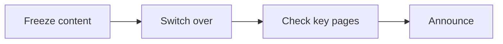

# Website relaunch: project update

The new site is on track to launch on **24 November**. Content migration finished this week,
and accessibility testing starts on Monday.

> [!NOTE]
> The current site stays online until launch day.

## Milestones

| Milestone | Owner | Due | Status |
|---|---|---|---|
| Content migrated | Content team | 24 Oct | Done |
| Accessibility tests | Quality team | 7 Nov | Next |
| Launch | Web team | 24 Nov | On track |

## Launch day

## Next steps

- Book the launch-day checks with the support desk.
- Send the announcement draft for review by 14 November.
