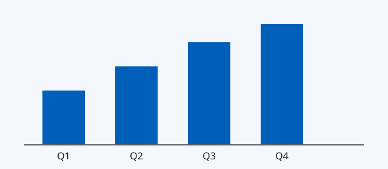
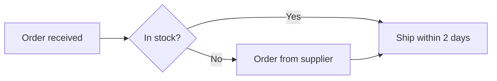
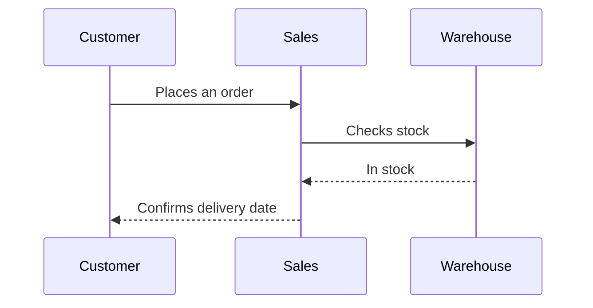

# Quarterly operations review

This review covers the third quarter: what went well, what slipped and what we propose for the
next. It reads like a document, with *emphasis*, **strong text**, ~~a struck phrase~~, `inline code`,
a [link to the plan](https://example.com/plan "The plan"), and a bare address, https://example.com.

## Summary

Revenue grew for the third quarter in a row, while costs held steady. Two projects slipped by a
few weeks; neither threatens the year's targets.[^targets]

> The best quarter since the reorganisation: steady, not spectacular, and built on work that
> will keep paying off.

### What we'll do next

1. Close the two slipped projects by the end of November.
2. Hire the two analysts approved in July.
   - One for planning
   - One for reporting
3. Review the supplier contracts before they renew.

- [x] Budget approved
- [x] Hiring plan agreed
- [ ] Supplier review booked

#### A fourth-level heading

##### A fifth-level heading

###### A sixth-level heading

Text under the smallest heading.

## Figures

| Region | Revenue | Change | Notes |
|--------|---------|--------|-------|
| North  | 1,250,000 | 4.5% | Ahead of plan |
| South  | 980,400 | -1.2% | Two late orders |
| East   | 1,104,250 | 2.0% | On plan |
| West   | (12,500) | 0% | One-off write-down |

A wide table scrolls inside its own frame:

| Account | January | February | March | April | May | June | July | August | September | Owner | Comment |
|---------|--------:|---------:|------:|------:|----:|-----:|-----:|-------:|----------:|-------|---------|
| Operating costs | 120,400 | 118,900 | 121,300 | 119,800 | 122,100 | 120,600 | 123,000 | 121,900 | 124,300 | Operations | Within budget all year |
| Marketing | 45,000 | 52,500 | 48,250 | 61,000 | 58,750 | 49,900 | 44,100 | 47,800 | 55,200 | Marketing | Spring campaign in April |

A long table keeps its header in view:

| # | Region | Orders | Share | Status |
|---|--------|--------|-------|--------|
| 01 | Region B | 1,337 | 3.5% | On track |
| 02 | Region C | 1,474 | 7.0% | On track |
| 03 | Region D | 1,611 | 10.5% | Review |
| 04 | Region E | 1,748 | 14.0% | On track |
| 05 | Region F | 1,885 | 17.5% | On track |
| 06 | Region A | 2,022 | 21.0% | Review |
| 07 | Region B | 2,159 | 24.5% | On track |
| 08 | Region C | 2,296 | 28.0% | On track |
| 09 | Region D | 2,433 | 31.5% | Review |
| 10 | Region E | 2,570 | 35.0% | On track |
| 11 | Region F | 2,707 | 38.5% | On track |
| 12 | Region A | 2,844 | 42.0% | Review |
| 13 | Region B | 2,981 | 45.5% | On track |
| 14 | Region C | 3,118 | 49.0% | On track |
| 15 | Region D | 3,255 | 52.5% | Review |
| 16 | Region E | 3,392 | 56.0% | On track |
| 17 | Region F | 3,529 | 59.5% | On track |
| 18 | Region A | 3,666 | 63.0% | Review |
| 19 | Region B | 3,803 | 66.5% | On track |
| 20 | Region C | 3,940 | 70.0% | On track |
| 21 | Region D | 4,077 | 73.5% | Review |
| 22 | Region E | 4,214 | 77.0% | On track |
| 23 | Region F | 4,351 | 80.5% | On track |
| 24 | Region A | 4,488 | 84.0% | Review |
| 25 | Region B | 4,625 | 87.5% | On track |

## Notes and warnings

> [!NOTE]
> Figures are unaudited until the year-end close.

> [!TIP]
> Filter the table by region to compare quarters.

> [!IMPORTANT]
> The supplier contracts renew automatically on 1 January.

> [!WARNING]
> Two projects slipped; their new dates are in the appendix.

> [!CAUTION]
> Don't share these figures outside the company before the results are published.

## Code

```python
def growth(previous: float, current: float) -> float:
    """The change between two quarters, as a percentage."""
    if previous == 0:
        return 0.0
    return round((current - previous) / previous * 100, 1)  # one decimal place
```

```rust
fn main() {
    let regions = ["North", "South", "East", "West"];
    for (i, region) in regions.iter().enumerate() {
        println!("{i}: {region} — a long line that runs past the edge of the panel to show it scrolls inside the block");
    }
}
```

```
Plain text with no language: no colours, still a Copy button.
```

## Pictures



A picture that isn't there: 

A picture from the internet: 

## Diagrams





```mermaid
flowchart LR
  A --> 
  this is not a diagram ((
```

---

[^targets]: The year's targets are in the annual plan, section 3.
